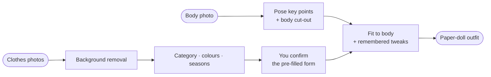

<h1 align="center">iMannequin</h1>

<b>Your wardrobe on a paper mannequin of yourself.</b> 
Photograph your clothes, let on-device AI sort them, and try outfits on before you put them on.

  
  
  
  
  
  

> **Status:** product decisions are recorded and the visual design is next. There's nothing to install yet; this page will get a QR code, screenshots and a demo once the first version is out.

## What it does

1. **Make your mannequin.** Take one photo of yourself in an A-pose. iMannequin finds your shoulders, waist, hips, knees and feet and cuts you out of the background. Prefer not to see your photo? Switch the mannequin to an outline.
2. **Photograph your clothes.** Lay each piece flat on a plain background and snap away. A small AI model on the phone removes the background, and another suggests the category, colours and seasons. You check a short pre-filled form and save.
3. **Dress up.** Tap the torso, legs, feet or head on your mannequin and everything you own for that part slides up. Swipe through it to see each piece on you, layer a shirt, sweater and coat, and save the outfit.
4. **Know what you have and where it is.** Every item can have a storage place, like "under the bed" or "in the sofa". Search by description, see what you haven't worn in months, move a whole season into storage at once, and build packing lists for trips.

## Planned features

- **Paper-doll try-on:** garments are scaled to your body and keep their own proportions, so a cropped top looks cropped and a midi dress ends below the knee. Fix a fit once by dragging its handles, and it's remembered for that garment.
- **AI that suggests, never decides:** cut-out, category, colours, seasons and name are pre-filled, and you can change all of them. A bad cut-out can be retried with another model or fixed with an erase / restore brush.
- **Bulk adding:** a camera loop and a gallery import feed a "To review" inbox.
- **Same-item detection:** photograph the same jeans twice and the app offers to add the photo to the existing item.
- **Search by description**, using small on-device language models.
- **Outfits, wear log and a "not worn lately" list.**
- **Storage places and seasonal swap.**
- **Packing lists**, grouped by where each item is stored.
- **Share an outfit** as an image.
- **Weather hint:** optional, and off by default.
- **English and Ukrainian.**
- **Backup and restore** to a single file.

## How it works

Everything runs in the browser on the phone: React and TypeScript, IndexedDB for storage, Transformers.js and MediaPipe for the AI models, installed as a Progressive Web App and hosted on GitHub Pages. Details: [architecture](docs/architecture.md) and [try-on](docs/try-on.md).

## Privacy

- **Your photos never leave your phone.** There's no server, no account and no analytics.
- The only network traffic is downloading the app and its AI models. The one exception is the weather hint, and only if you switch it on: it sends a location to the free Open-Meteo service.
- Deleting the app deletes your wardrobe, so the app makes backup files you keep yourself (iCloud Drive, Google Drive, anywhere).

## Documentation

| Doc | Contents |
|---|---|
| [PRD](PRD.md) | Features, body zones and categories, non-goals, success criteria |
| [Decisions](docs/decisions.md) | Rules, every decision with its reasoning, open questions |
| [Architecture](docs/architecture.md) | Stack, AI pipeline and candidate models, data model, storage, privacy |
| [Mannequin & try-on](docs/try-on.md) | Body processing, garment anchors, automatic fit, layering |
| [Design](docs/design.md) | Black-and-white paper-cut style, motion, screens |

## Licence

[MIT](LICENSE). Every model and library the app uses has a permissive licence (MIT, Apache or BSD).
