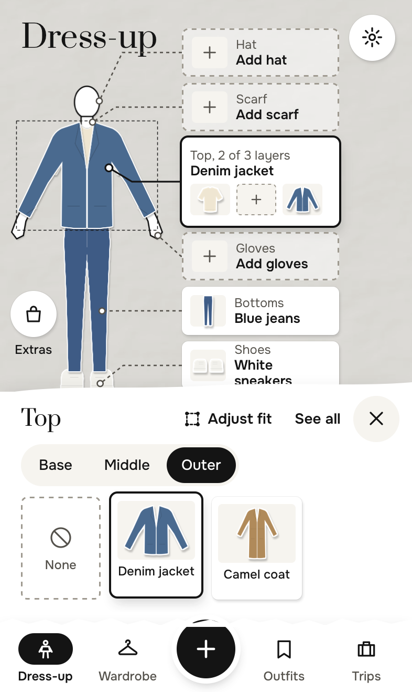
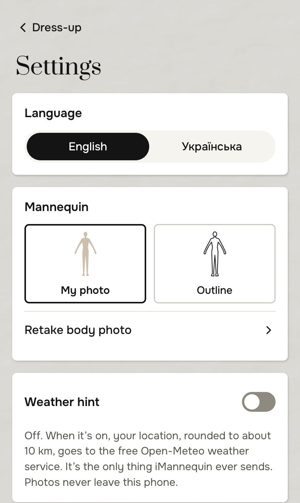

<p align="center"></p>

<h1 align="center">iMannequin</h1>

<p align="center"><b>Your wardrobe on a paper mannequin of yourself.</b><br>
Photograph your clothes, let on-device AI sort them, and try outfits on before you put them on.</p>

<p align="center">
  <a href="https://github.com/Nik-Kras/iMannequin/actions/workflows/deploy.yml"></a>
  
  
  
  
  
  <a href="LICENSE"></a>
</p>

## Install

<table><tr>
<td></td>
<td>

**Scan with your phone's camera**, or open **[nik-kras.github.io/iMannequin](https://nik-kras.github.io/iMannequin/)**.

- **iPhone:** in Safari, tap Share → **Add to Home Screen**.
- **Android:** in Chrome, tap the menu → **Install app**.

It's free, there's no account, and after the first launch it works offline.

</td>
</tr></table>

> **Status: beta.** Every feature is in. AI model choices are being calibrated on real phones through the in-app Model lab (Settings → Model lab).

<p align="center">
  
  
  
  
</p>
<p align="center"><sub>Screenshots use the synthetic sample wardrobe (drawn garments and an outline mannequin), never real photos.</sub></p>

## What it does

1. **Make your mannequin.** Take one photo of yourself in an A-pose. iMannequin finds your shoulders, waist, hips, knees and feet and cuts you out of the background. Prefer not to see your photo? Switch the mannequin to an outline.
2. **Photograph your clothes.** Lay each piece flat on a plain background and snap away. A small AI model on the phone removes the background, and another suggests the category, colours and seasons. You check a short pre-filled form and save.
3. **Dress up.** Tap the torso, legs, feet or head on your mannequin and everything you own for that part slides up. Swipe through it to see each piece on you, layer a shirt, sweater and coat, and save the outfit.
4. **Know what you have and where it is.** Every item can have a storage place, like "under the bed" or "in the sofa". Search by description, see what you haven't worn in months, move a whole season into storage at once, and build packing lists for trips.

## Features

- **Paper-doll try-on:** garments are scaled to your body and keep their own proportions, so a cropped top looks cropped and a midi dress ends below the knee. Fix a fit once by dragging its handles, and it's remembered for that garment.
- **AI that suggests, never decides:** cut-out, category, colours, seasons and name are pre-filled, and you can change all of them. A bad cut-out can be retried with another model or fixed with an erase / restore brush.
- **Bulk adding:** a camera loop and a gallery import feed a "To review" inbox.
- **Same-item detection:** photograph the same jeans twice and the app offers to add the photo to the existing item.
- **Search by description**, using small on-device language models.
- **Outfits, wear log and a "not worn lately" list.**
- **Storage places and seasonal swap.**
- **Packing lists**, grouped by where each item is stored.
- **Share an outfit** as an image.
- **Weather hint:** optional, and off by default.
- **English and Ukrainian.**
- **Backup and restore** to a single file.

## How it works


Everything runs in the browser on the phone: React and TypeScript, IndexedDB for storage, Transformers.js (WebGPU, or WebAssembly as the fallback) and MediaPipe for the AI models, installed as a Progressive Web App and hosted on GitHub Pages. The AI runtimes and pose models are served from this site, not a CDN. Details: [architecture](docs/architecture.md) and [try-on](docs/try-on.md).

## Privacy

- **Your photos never leave your phone.** There's no server, no account and no analytics.
- The only network traffic is downloading the app and its AI models. The one exception is the weather hint, and only if you switch it on: it sends a location to the free Open-Meteo service.
- Deleting the app deletes your wardrobe, so the app makes backup files you keep yourself (iCloud Drive, Google Drive, anywhere).

## Development

```bash
pnpm install
pnpm dev          # http://localhost:5173/iMannequin/  (add ?seed to load the sample wardrobe)
pnpm test         # unit tests (Vitest)
pnpm e2e          # end-to-end tests in WebKit on an iPhone profile (Playwright)
pnpm build        # production build in dist/
```

Pushing to `main` builds and deploys to GitHub Pages.

## Documentation

| Doc | Contents |
|---|---|
| [PRD](PRD.md) | Features, body zones and categories, non-goals, success criteria |
| [Decisions](docs/decisions.md) | Rules, every decision with its reasoning, open questions |
| [Architecture](docs/architecture.md) | Stack, AI pipeline and candidate models, data model, storage, privacy |
| [Mannequin & try-on](docs/try-on.md) | Body processing, garment anchors, automatic fit, layering |
| [Design](docs/design.md) | Black-and-white paper-cut style, motion, screens |

## Licence

[MIT](LICENSE). Every model and library the app uses has a permissive licence (MIT, Apache or BSD).
