<p align="center">
  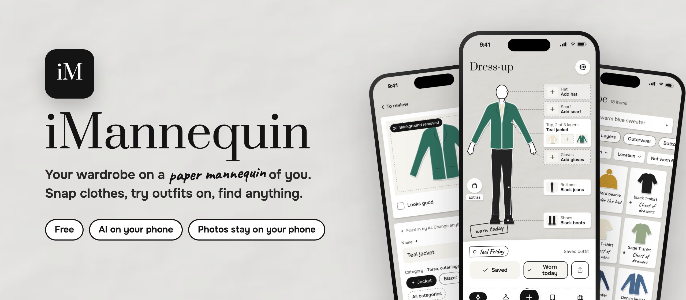
</p>

<p align="center">
  <a href="https://github.com/Nik-Kras/iMannequin/actions/workflows/ci.yml"></a>
  <a href="https://nik-kras.github.io/iMannequin/"></a>
  
  
  
  
  
  <a href="LICENSE"></a>
</p>

<p align="center">
  <a href="docs/promo.mp4">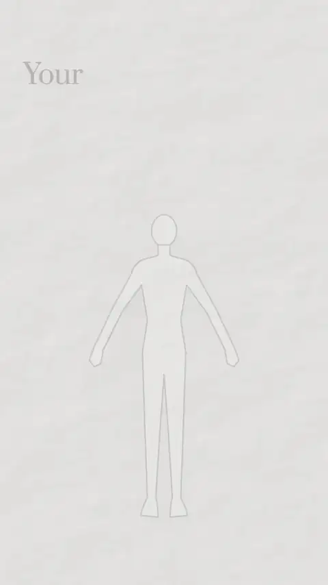</a>
  <br>
  <sub>▶ <a href="docs/promo.mp4">Watch with sound</a> (25 s)</sub>
</p>

**iMannequin** puts your wardrobe on a paper mannequin of you. Photograph your clothes one by one and a small AI model on the phone cuts each piece out of the background and names it: "Teal jacket", category Jacket, teal, spring and autumn. Then tap a part of the mannequin and try on what you own, layer by layer, before you open the wardrobe.

It also knows **where everything is kept**. Clothes end up spread across a wardrobe, a chest of drawers, a box under the bed and the storage inside the sofa, so every item has a place, and "under the bed" is a search. Packing for a trip becomes one walk round the flat. It's free, installs from a link on iPhone and Android, and the photos never leave the phone.

## Install


Scan the QR code with your phone's camera, or open **[nik-kras.github.io/iMannequin](https://nik-kras.github.io/iMannequin/)**.

- **iPhone:** in Safari, tap **Share**, then **Add to Home Screen**.
- **Android:** in Chrome, tap the menu, then **Install app** (or **Add to Home screen**).

Open **iMannequin** from the home screen. The first launch downloads the AI models (about 206 MB, once); after that it works offline. New versions arrive on their own: the app says «A new version is ready» with a **Reload** button. Your wardrobe stays.

<br clear="right">

## What it does

### Snap your clothes
- **Point the camera, tap, next.** Lay a piece flat on a plain background and keep shooting; a strip shows each photo being cut out. Or import a batch from the gallery.
- **The AI fills in the form, you decide.** The background is removed, and the name, category (33 of them, from T-shirts to swimwear), colours and seasons are suggested. Everything the AI filled in is marked ✦ and can be changed. A messy cut-out can be redone with another model or fixed with an erase / restore brush.
- **"Save and next · 2 of 5"** walks through new pieces without scrolling, and suggests the place you used last.
- **Same item twice?** Photograph the same jeans again and it offers to add the photo to the existing item.

### Try outfits on a paper you
- **Your mannequin** comes from one photo of you in an A-pose: MediaPipe finds 33 body points and the cut-out model draws a sharp outline. Prefer not to see your photo? Switch to an outline mannequin.
- **Tap a body part** (head, neck, torso, hands, legs, feet) and a row of everything that fits slides up. Tops take three layers (base, middle, outer), and trousers can tuck into boots.
- **Garments keep their proportions**, so a cropped top looks cropped and a midi dress ends below the knee. Drag a piece's handles once and the fit is remembered for that garment.
- **Save outfits**, log what you wore today, and share a look as an image.

### Know what you have and where it is
- **Places:** every item can live somewhere, such as "Under the bed" or "Sofa box". Search understands them, along with colours, seasons, categories and warmth, in English and Ukrainian: "warm blue sweater", "under the bed".
- **Not worn in 6 months** lists what to wear or give away; the **wear log** is a calendar you can correct day by day.
- **Seasonal swap** moves a whole season into storage in one go.
- **Packing lists** group a trip's outfits and pieces by where they're kept, and stamp each one as packed.
- **Backup to one file** (iCloud Drive, Google Drive, anywhere), because deleting a home-screen app deletes its data. Settings shows when you last made one.

English and Ukrainian, Text Size and Reduce Motion respected, VoiceOver labels throughout, and an optional weather hint (off by default).

## Screenshots

| Dress-up | Try a piece on | Snap | Filled in by AI |
|:---:|:---:|:---:|:---:|
| 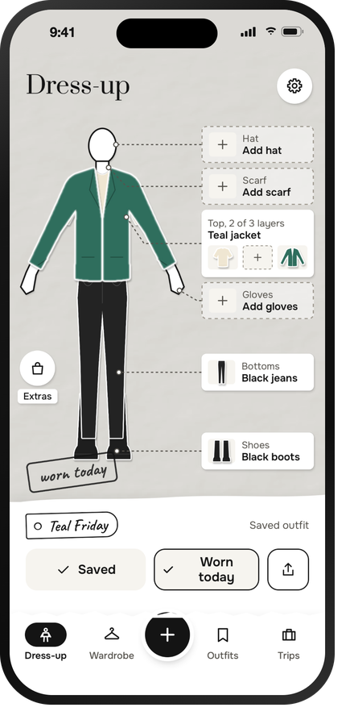 | 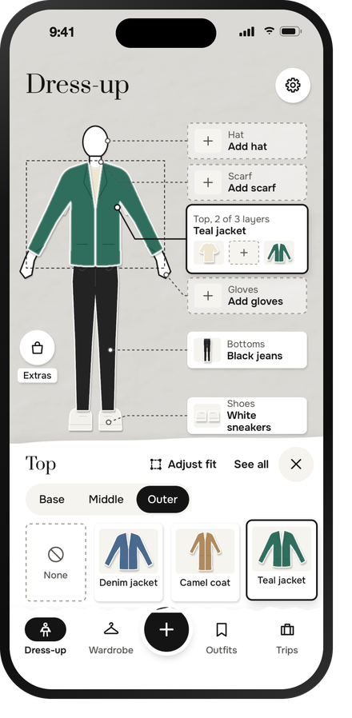 | 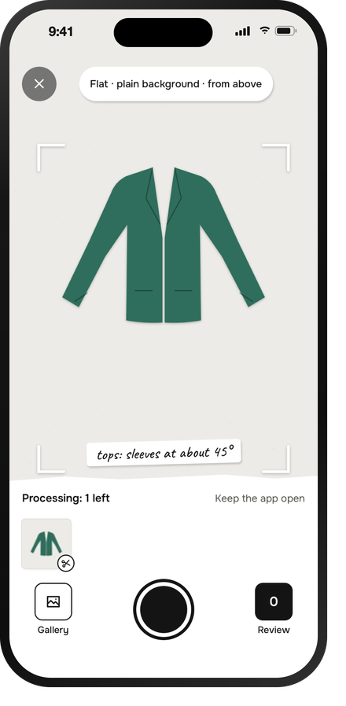 | 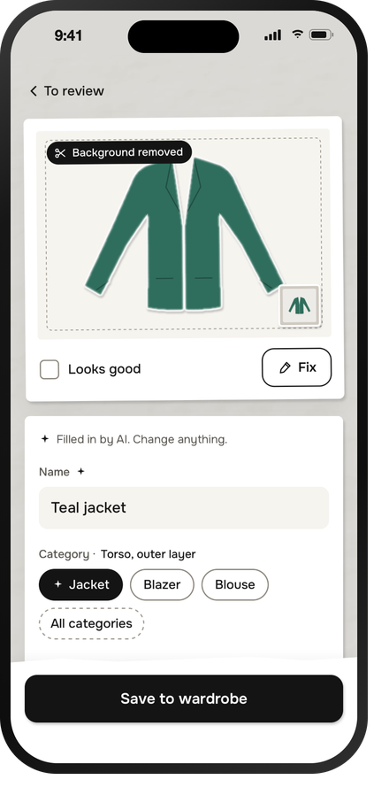 |
| **Wardrobe** | **"under the bed"** | **Places** | **Packing** |
| 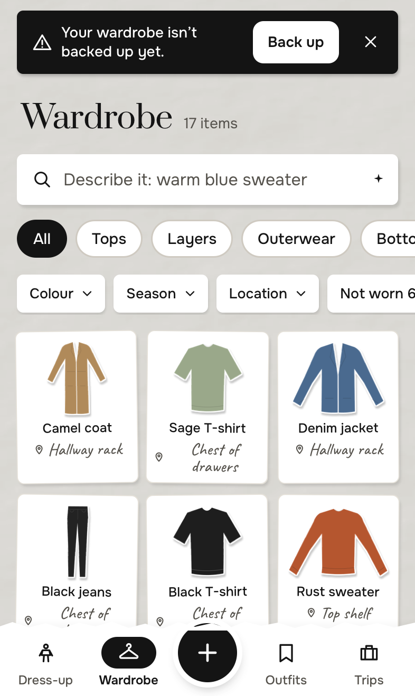 | 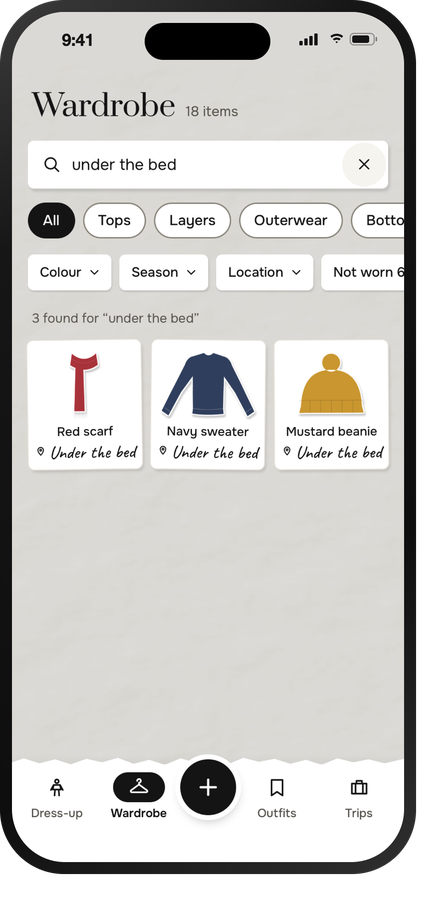 | 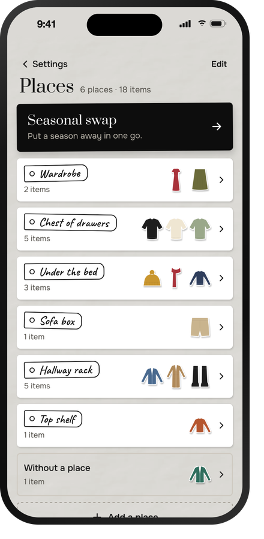 | 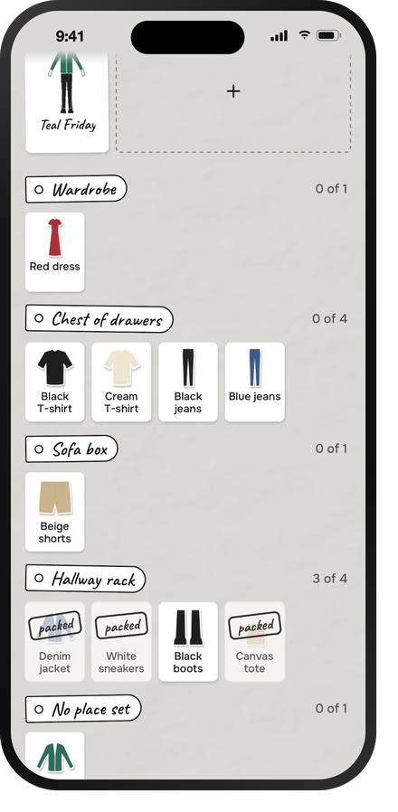 |
| **Outfits** | **Wear log** | **Make your mannequin** | **Model lab** |
| 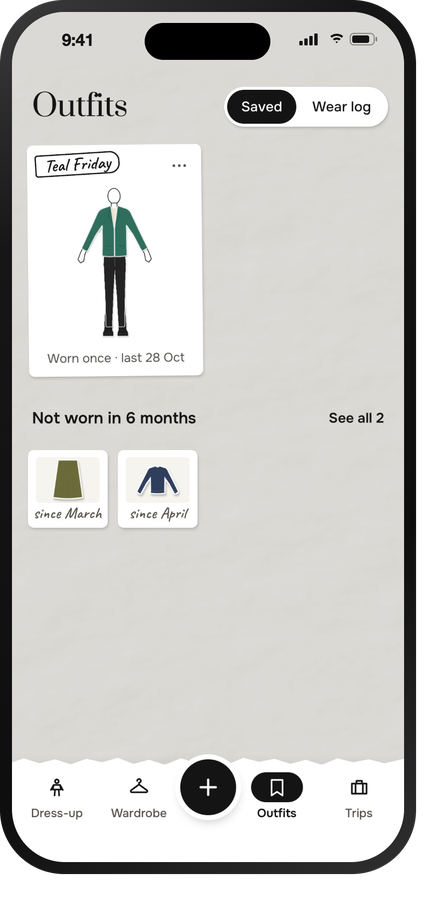 | 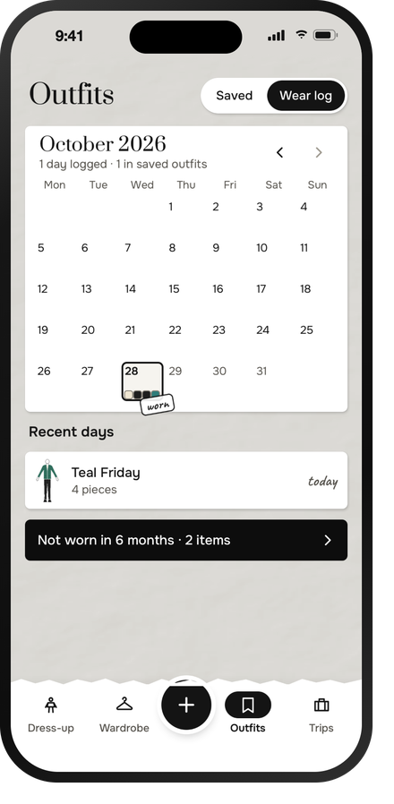 | 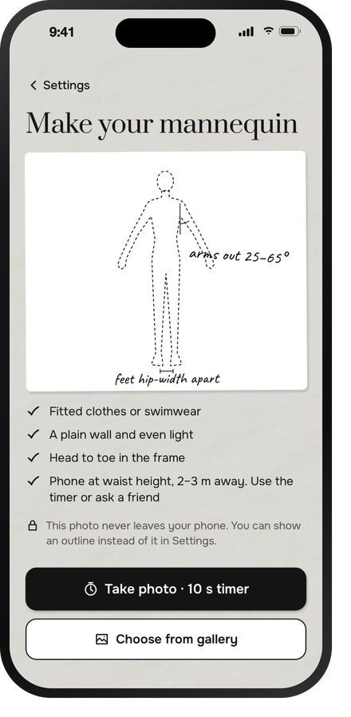 | 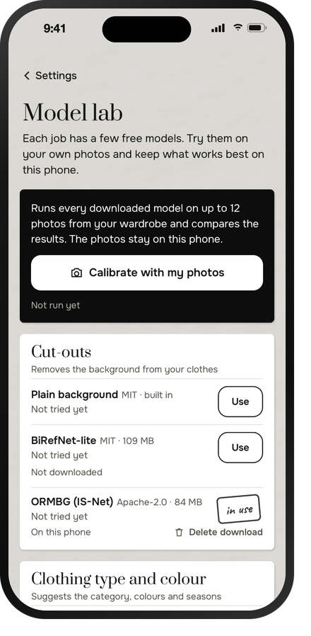 |

<sub>Everything shown is synthetic: the app's drawn sample wardrobe, a drawn jacket in front of a fake camera, and the outline mannequin. No real photos are used anywhere in this repo.</sub>

## How a photo becomes a garment

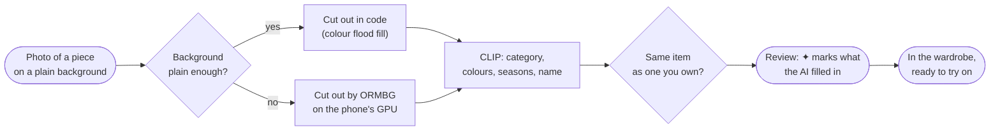

## How the mannequin wears it

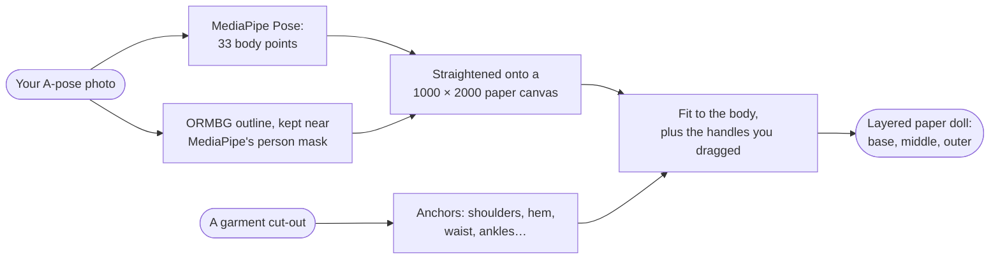

The details are in [docs/try-on.md](docs/try-on.md).

## The AI models

Every model runs in the browser on the phone (Transformers.js on WebGPU, or WebAssembly where there's no GPU), is downloaded once, and has a permissive licence. Model lab (Settings → Model lab) runs them all on your own photos so you can keep what works best on your phone.

| Job | Default | Alternatives | Licence |
|---|---|---|---|
| Cut-out | ORMBG (IS-Net), 84 MB | BiRefNet-lite; plain background in code | Apache-2.0 · MIT |
| Category, colours, seasons | CLIP ViT-B/32, 122 MB | FashionCLIP | MIT |
| Body points | MediaPipe Pose lite, 5.5 MB (served with the app) | MediaPipe Pose full | Apache-2.0 |
| Search by description | Plain filters first; Qwen3-1.7B only when you tap "Search smarter" | Qwen2.5-1.5B, Qwen3-0.6B | Apache-2.0 |

## Privacy

Your photos, clothes, places and outfits live only in the phone's storage (IndexedDB). There's no server, no account and no analytics. Only these requests leave the phone:
- **the app's files** from GitHub Pages, and **the AI models** from Hugging Face, once;
- **crash reports** to Sentry: the step that failed, the error, the phone, the OS and the GPU. Never photos, garment names, brands, places, notes or locations. They can be switched off in Settings → Crash reports;
- **the weather hint**, only if you switch it on: a location rounded to about 10 km goes to Open-Meteo.

MediaPipe's own usage logging to Google is blocked inside the app, and an end-to-end test checks that the body-photo step contacts nothing but the app itself and Sentry.

## Architecture

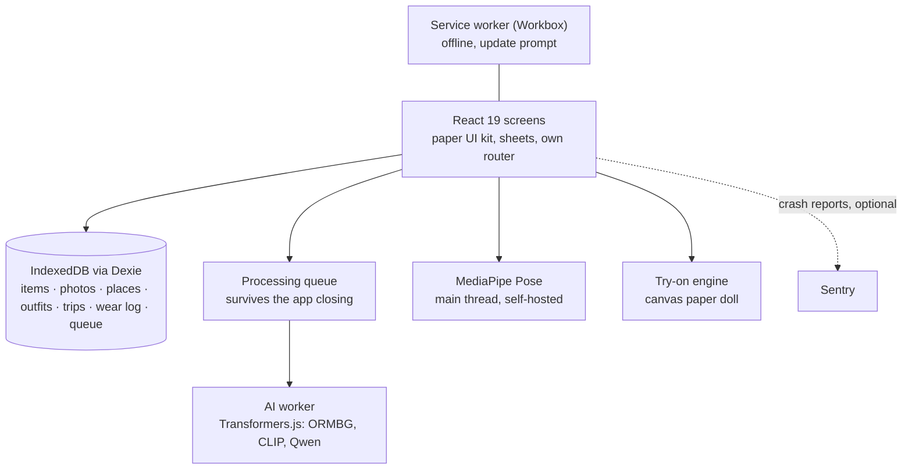

- **No server.** A static site on GitHub Pages that installs as a home-screen web app and precaches everything it needs.
- **One AI model in memory at a time.** iPhone Safari closes a tab at about 2 GB, so the queue cuts out a batch of photos, then analyses them, and frees the models when it's done. A worker that has used the GPU is reused, never terminated (terminating it crashes WebKit).
- **Photos are written once.** WebKit can lose a stored image when the record holding it is rewritten, so queued photos sit in their own write-once table, and every rewrite copies images into memory first.
- **Built for the phone:** Back and the edge swipe close sheets first, drafts survive iOS closing the app, sheets rise above the keyboard, text follows the phone's text size, and every save says when it fails.

## Quality

- **207 unit tests** (Vitest) for the logic: the processing queue, worker lifecycle, backup and restore, search parsing, the pose check and body masks, garment fitting, naming, reminders and the crash black box.
- **156 end-to-end tests on two phones** (Playwright): an iPhone in WebKit, Safari's engine, and an Android phone in Chromium, Chrome's engine. They run every flow with a fake camera and synthetic garments; a few run the real cut-out, classification and pose models to catch memory crashes and privacy leaks.
- **A five-agent bug audit** found 50 issues, from lost photos to tap targets, and the first days on a real phone and in CI found five more. Each one has a test named after it that failed on the old code and passes now ([docs/bug-audit.md](docs/bug-audit.md)).
- **CI** runs the type check, unit tests and both phones' end-to-end tests on every push; main deploys only when they pass.
- **Crash reports** from real phones (Sentry, with an on-phone black box that reports out-of-memory closes on the next launch).

## Develop

```bash
pnpm install
pnpm dev                       # http://localhost:5173/iMannequin/   (add ?seed for the sample wardrobe)
pnpm test                      # unit tests
pnpm build && pnpm preview     # production build on http://localhost:4183/iMannequin/
pnpm e2e                       # end-to-end tests on both phones against the preview (--project=iphone or android)
```

`IMQ_PORT` runs the preview and the tests on another port. `IMQ_MODEL_MIRROR=<folder>` serves the real AI models from a local copy (laid out as `<org>/<repo>/<file>`); without it, the tests that need them are skipped.

Every push runs the checks and both phones' tests (`.github/workflows/ci.yml`); a push to `main` then builds and deploys to GitHub Pages, only if they pass. With the `SENTRY_AUTH_TOKEN` secret set, the build uploads source maps to Sentry and removes them from the site.

## Project structure

```
src/
├── app/        Shell: router, tab bar, toasts, install and update prompts
├── screens/    Dress-up, Wardrobe, Add clothes, Review, Item form, Fix cut-out, Body photo,
│               Outfits, Wear log, Trips, Places, Season swap, Share, Settings, Model lab
├── ai/         AI worker and client, model registry, cut-out, CLIP, pose, search, downloads
├── tryon/      Body processing, garment anchors, fitting, layering, the paper-doll mannequin
├── wardrobe/   Images, naming, queue errors, review session
├── life/       Outfits, wear log, trips, reminders
├── data/       Dexie database, processing queue, backup and restore
├── domain/     Types and the garment taxonomy (zones, slots, 33 categories)
├── diag/       Sentry crash reports and the on-phone black box
├── i18n/       English and Ukrainian
├── ui/         Paper UI kit: sheets, chips, switches, icons, actions
└── styles/     Tokens and screen styles
tests/unit/     Vitest
tests/e2e/      Playwright (WebKit, iPhone size)
docs/           Decisions, architecture, try-on, design, bug audit
```

## Documents

- [PRD](PRD.md): who it's for, every feature, body zones and categories
- [Decisions](docs/decisions.md): 63 decisions, each with the options considered and why
- [Architecture](docs/architecture.md): stack, AI pipeline, data model, storage, privacy, diagnostics
- [Mannequin & try-on](docs/try-on.md): body processing, garment anchors, fitting, layering
- [Design](docs/design.md): the black-and-white paper-cut style, type, colour, components
- [Bug audit](docs/bug-audit.md): 55 issues found and fixed, each with its test

## Disclaimer

The try-on is a 2D paper doll that shows how pieces go together, not how a size will fit. AI suggestions can be wrong; check them before you save.

## License

[MIT](LICENSE) © 2026 Nikita Krasnytskyi. Every model and library the app uses has a permissive licence (MIT, Apache or BSD).
