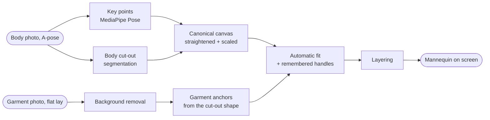

# Mannequin & try-on

How a flat photo of a garment ends up on the user's body. This is a **2D paper doll** (D5): garments are cut out, scaled, placed and layered. Nothing is redrawn or generated.

Legend: **Decided** = approved by the owner · **Proposed ⚑** = waiting for approval or for calibration on real phones.

## 1. Pipeline

## 2. The body (decided: D13, D14)

### 2.1 Capture
- **A-pose:** arms straight, about 45° away from the body, palms forward or in, feet hip-width apart, facing the camera.
- Fitted clothing or swimwear, a plain wall, even light, head to toe in frame, phone at waist height about 2–3 m away. A self-timer or someone else holding the phone.

### 2.2 Processing
1. **Key points:** MediaPipe Pose Landmarker returns 33 points. iMannequin uses:

   | Points | Indexes |
   |---|---|
   | nose | 0 |
   | eyes | 2, 5 |
   | ears | 7, 8 |
   | shoulders | 11, 12 |
   | elbows | 13, 14 |
   | wrists | 15, 16 |
   | hips | 23, 24 |
   | knees | 25, 26 |
   | ankles | 27, 28 |
   | heels | 29, 30 |
   | toes | 31, 32 |

2. **Cut-out:** a segmentation mask of the body.
3. **Pose check** ⚑: refuse the photo with a clear reason if any of these fail:
   - **Visibility:** a point is missing or has low visibility.
   - **Arm angle:** the shoulder → wrist angle is outside 25°–65° from vertical.
   - **Facing:** the body is turned. That shows as the shoulders being much narrower than the hips, or the ear and shoulder points being badly asymmetric.
   - **Framing:** the feet or head are cut off.
4. **Canonical canvas** ⚑:
   - Rotate so the line from mid-shoulders to mid-ankles is vertical.
   - Scale so the body is 1800 units tall, from the top of the mask to the heels.
   - Centre it on a 1000 × 2000 canvas.
   - Every later calculation uses canonical coordinates.
5. **Body widths** come from the **mask**, not the key points. The pose points sit at the joint centres, and clothes sit on the outside of the body:
   - **shoulder width:** the mask at shoulder height
   - **waist width:** the narrowest row between shoulders and hips
   - **hip width:** the mask at hip height
   - **head width:** the mask at ear height

### 2.3 Display modes (D13)
- **Photo** (default): the body cut-out.
- **Outline:** the same mask drawn as a white paper cut-out with a black edge and a soft paper shadow. It's the same shape, so every fit is identical in both modes.

## 3. Garment anchors ⚑

Anchors are found from the **cut-out mask** of a flat-lay photo with plain geometry. This works because the capture guide fixes how garments are laid out: sleeves at about 45°, trouser legs slightly apart. A garment-landmark model can replace this later if calibration shows the geometry isn't good enough.

| Category group | Anchors | How they're found |
|---|---|---|
| Tops, outerwear, dresses, jumpsuits | neckline centre, left / right shoulder, left / right armpit, hem centre + width, sleeve ends | Width profile of the mask, row by row. The torso width is the stable width below the armpits. The shoulders are the top corners at that width. The armpits are where the sleeves split from the torso. The sleeve ends are the furthest sleeve pixels |
| Trousers, jeans, shorts, leggings | waistband left / right, crotch, left / right hem | The top row is the waistband. The crotch is the top of the gap between the legs. Each hem is the bottom of its leg |
| Skirts | waistband left / right, hem left / right | Top and bottom rows |
| Shoes (pair from the front, Q8) | left / right sole centre, width | Two connected shapes, bottom centre of each |
| Hats, caps | brim left / right | The widest row in the lower part |
| Scarves, ties | top centre, width | Top row |
| Gloves | left / right cuff centre | Two shapes, top centre of each |
| Glasses | centre, width | Bounding box |
| Belts | left / right end | Furthest points |
| Bags | handle top | Top point |
| Jewellery | centre | Bounding box centre |

## 4. Automatic fit (decided: fit to body, D16)

A garment's **width** is matched to the body and its **proportions are kept**, so a cropped top ends above the waist and a midi dress ends below the knee.

| Group | Target on the body | Scale from | Layer ease ⚑ |
|---|---|---|---|
| Base tops, dresses, jumpsuits | shoulder edges at shoulder height | shoulder width | × 1.00 |
| Middle layer | same | shoulder width | × 1.05 |
| Outer layer | same | shoulder width | × 1.10 |
| Trousers, shorts, skirts, leggings | waist edges (skirts and low-rise: hip edges) | waist or hip width | × 1.00 (leggings × 0.97) |
| Shoes | heel–toe midpoint of each foot | a share of body height, set during calibration | n/a |
| Hats | top of the head, brim at ear height | head width × 1.15 | n/a |
| Glasses | the eye line | the distance between the ears × 0.9 | n/a |
| Scarves, ties | the neck point (mid-shoulders, raised) | shoulder width | n/a |
| Gloves | wrists | the wrist–hand length | n/a |
| Belts | the waist line | waist width | n/a |
| Bags | beside a hand | torso height | n/a |

- **Base transform:** a similarity transform (scale + rotation + move) that puts the two main anchors on their targets. For example, a top's left and right shoulders go on the body's shoulder edges.
- **Sleeves and legs** ⚑: the sleeve area (outside the armpits) is rotated about the shoulder to follow each arm's angle, and each trouser leg (below the crotch) about the hip to follow the leg. A soft blend hides the seam. This makes small differences between the body pose and the flat lay disappear.
- The "ease" factors make layers visible. A coat sits a little wider than the sweater under it. They're tuned during calibration.

## 5. Remembered adjustments (decided: D15)

- In **Adjust fit**, the user drags the anchor handles or moves, scales and rotates the whole garment.
- The result is stored **on the item** (`Item.fit`) as offsets from the automatic fit. The offsets are measured in the garment's reference length (shoulder width for tops, waist width for bottoms, head width for hats), not in pixels.
- It's applied every time that garment is worn, in every outfit, and it **survives a retaken body photo**: the automatic fit is recalculated and the same relative offsets are added.
- **Reset to automatic** clears it.

## 6. Layering ⚑

The default drawing order, bottom to top:

| # | Layer |
|---|---|
| 1 | Body (photo or outline) |
| 2 | Leggings |
| 3 | Base top **if Tuck in is on** |
| 4 | Shoes (**if Trousers into boots is off**) |
| 5 | Trousers, jeans, shorts, skirts |
| 6 | Shoes (**if Trousers into boots is on**) |
| 7 | Base top (untucked, the default) / dress / jumpsuit |
| 8 | Tie |
| 9 | Belt |
| 10 | Middle layer |
| 11 | Outer layer |
| 12 | Scarf |
| 13 | Gloves, bag, jewellery |
| 14 | Hat, glasses |

Slot rules:
- One item per slot: base top, middle, outer, legs, full body, feet, head, neck, hands. Accessories can be several.
- A **dress or jumpsuit** takes the base-top and legs slots. Picking one clears them, and picking a top or bottoms clears the dress.

## 7. What the paper doll can't show

- **Drape, wrinkles and how the fabric falls.** A flat lay looks flatter than the worn garment.
- **Fit and size.** Every garment is scaled to "fit" (D16), so it won't show that something is too tight or too long.
- **Back and side views.** It's front only.
- Shadows and lighting that differ between photos. The paper style (a flat drop shadow under every piece) is meant to make that look intentional.
